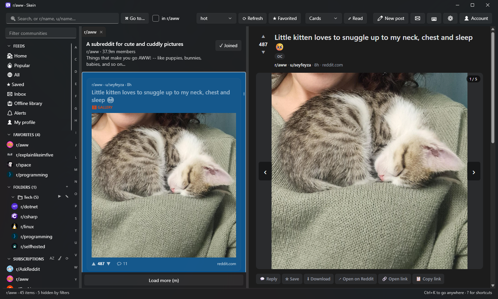
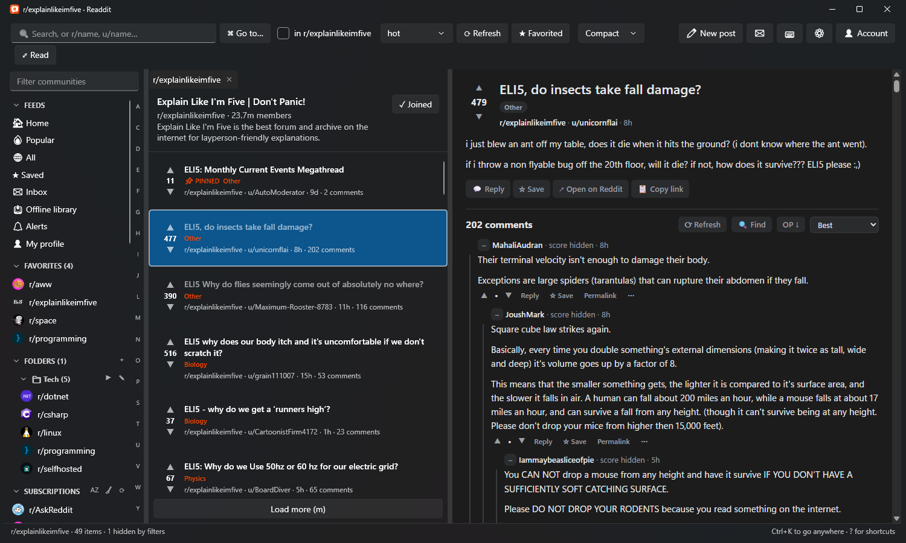
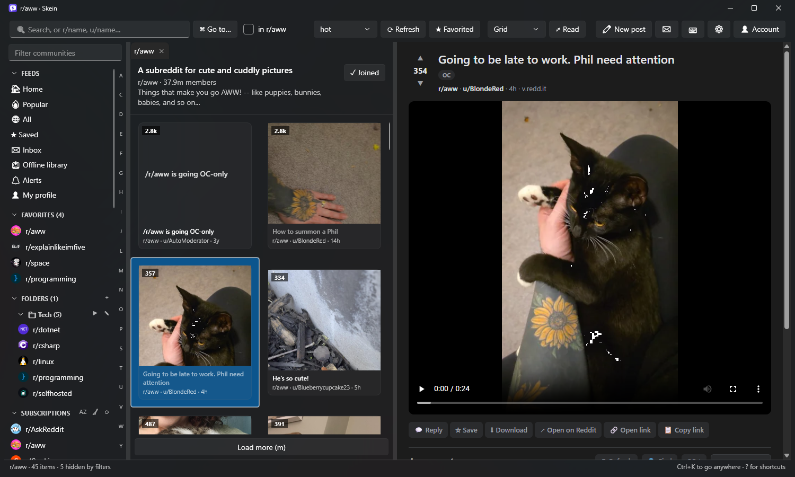
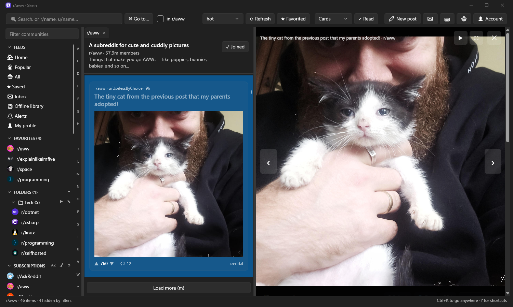
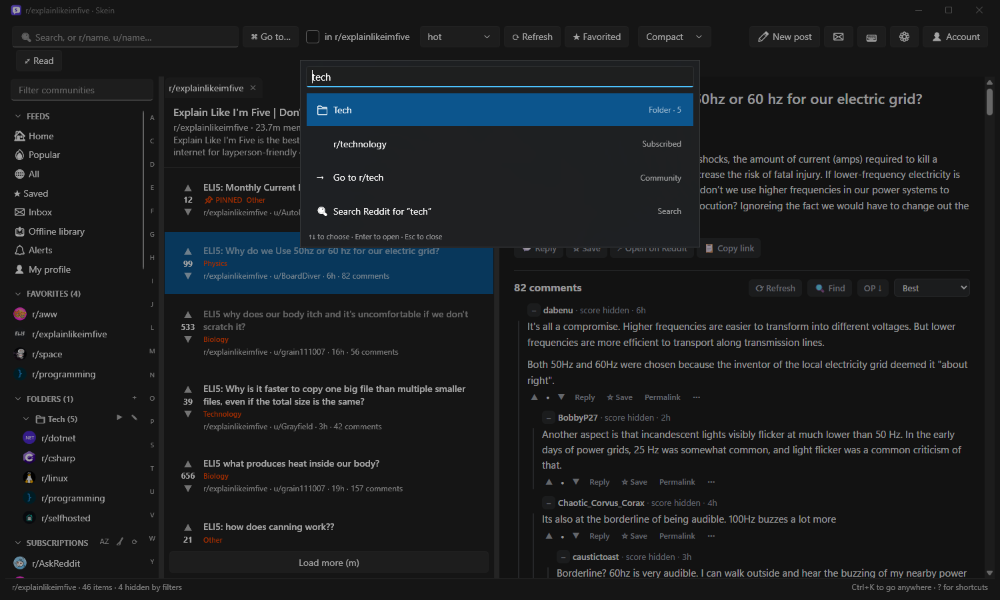

<p align="center">
  
</p>

<h1 align="center">Skein</h1>

<p align="center">A fast, keyboard-friendly desktop Reddit client for Windows.</p>

<p align="center">
  <a href="https://github.com/chrisdfennell/Skein/actions/workflows/release.yml"></a>
  <a href="https://github.com/chrisdfennell/Skein/releases/latest"></a>
</p>

---

Skein is a native Windows app (WPF on .NET 10) for browsing Reddit. It signs in through Reddit's own login page and reads Reddit through your session, so you don't need an API key. Your password only ever goes to Reddit.

> Skein is an independent project and isn't affiliated with or endorsed by Reddit. It was called Readdit until version 0.5; it moves your settings and data over by itself.



## Screenshots

| | |
| --- | --- |
|  |  |
| **Compact list and comments.** Threads collapse, and jump keys move between top-level comments, new comments or the original poster's. | **Picture grid.** Image-heavy communities as tiles. |
|  |  |
| **Picture viewer.** Arrow keys carry on into the next post's pictures. Space runs a slideshow, and F11 goes full screen. | **Command palette (Ctrl+K).** Jump to any community, folder, tab or command. |

## Features

**Browsing**
- Compact, card and picture-grid layouts, with infinite scroll.
- Tabs that are restored on restart, and a sidebar with your subscriptions and favorites, including community icons. It handles thousands of subscriptions, shows them instantly at launch, and has an A–Z jump bar and a most-visited sort. Star any community from the sidebar to make it a favorite.
- Tabs you haven't looked at for a while go to sleep to save memory, and wake up when you come back.
- The same link posted in several communities shows once in combined feeds, marked with where else it was posted.
- Folders: group communities your own way, and open a folder as one combined feed.
- A command palette (<kbd>Ctrl</kbd>+<kbd>K</kbd>) to jump to any community, folder, tab or command.
- Search with community suggestions as you type. Refine results by author, flair, site, titles only, or text posts versus links, and save searches to the sidebar.
- Community pages: rules, posting guidelines, sidebar, moderators and the wiki, all inside Skein.
- User profiles and subreddit info banners.
- Reading mode for distraction-free reading, with adjustable text size.
- Hover previews for thumbnails, usernames and image links.
- An in-app browser for links, signed in to Reddit.

**Posts and comments**
- Formatted text, Reddit video with sound, GIFs and galleries.
- A picture viewer that steps from one post's pictures into the next post's, with a slideshow and full screen (<kbd>F11</kbd>).
- Collapsible comment threads, "load more replies", and find-in-thread (Ctrl+F) that can load the whole thread.
- Jump between top-level comments, comments new since your last visit (highlighted), or the original poster's comments.
- Comment tools: collapse or expand every thread, show only the original poster, people you highlight, new comments or your own, and a highlights box (top comments, the busiest thread, the original poster's replies) on big threads.
- Vote, save, reply, and edit or delete your own posts and comments, with spell check and a formatting toolbar (<kbd>Ctrl</kbd>+<kbd>B</kbd>, <kbd>I</kbd>, <kbd>K</kbd>). Write in Markdown with a live preview, or switch to rich text and Skein turns it into Markdown for you. Unsent replies and edits are kept as drafts.
- New posts: text, links, a picture, a gallery of up to 20, or a video. Unfinished posts are kept as drafts too. The community's rules are shown alongside, you can pick a post flair, and the text box has the same toolbar and rich text mode.
- Read aloud (<kbd>Shift</kbd>+<kbd>R</kbd>): listen to a post and its comments, with pause and skip.

**Moderation** (for communities you moderate)
- Mod queues in the sidebar: one for all your communities plus one per community, covering the queue, reports, unmoderated, spam and edited items.
- Approve, remove, mark as spam, lock, pin, distinguish, mark NSFW or spoiler, ignore reports, and ban users with a reason, duration and message.
- Report reasons and approved/removed badges are shown inline. Quick approve, remove and spam are in the post list's right-click menu.

**Power features**
- Filters: keywords, domains, subreddits, minimum score, auto-collapsing low-scored comments, muted users and highlighted users.
- Read tracking (hide or dim posts you've opened) and hiding posts.
- Notifications for replies and messages, with a system tray icon. A single new message can be answered straight from its notification.
- Private messages: write new ones, read each conversation as one thread, and browse inbox folders (unread, messages, comment and post replies, mentions, sent).
- Mini mode (<kbd>Ctrl</kbd>+<kbd>M</kbd>): a small window, on top of your others if you like, for keeping an eye on one feed.
- Keyword alerts: get notified when new posts match your words, anywhere on Reddit or in communities you pick.
- Watch a thread to be told when it gets new comments, and follow users to be told when they post.
- Private notes and tags on users, shown next to their names.
- Subscription cleanup: find banned, private, quarantined and long-quiet communities and unsubscribe in one go.
- An offline library: saved posts are kept with their comments and media. Pull in everything you've saved on Reddit, then search, tag and export it (Markdown, HTML, CSV or JSON).
- Open reddit links from other apps in Skein (optional; other links still go to your browser), plus `skein://` links.
- One-click download of images, galleries and video (merged with sound if [ffmpeg](https://ffmpeg.org) is installed).
- Multiple accounts.
- Sync between PCs: folders, alerts, user notes, filters and appearance stay the same on every PC, through a shared folder such as OneDrive.
- Back up and restore your settings, notes, alerts and (optionally) your offline library as a single file.
- Report a problem from Preferences: Skein bundles its logs, with personal details removed, and opens a GitHub issue.
- Light, dark and true-black themes, with accent colors and an interface size setting.
- Automatic updates.

Press <kbd>?</kbd> in the app for all keyboard shortcuts (`j`/`k` to move, `a`/`z` to vote, `f` for reading mode, and more).

## Install

From the [latest release](https://github.com/chrisdfennell/Skein/releases/latest), download one of these:

- **`Skein-win-Setup.exe`** installs Skein with a desktop icon and a Start menu entry. It updates itself when new releases come out.
- **`Skein-Portable.exe`** is a single file you can run from anywhere, including a USB stick, with no install. It doesn't auto-update. On first run it unpacks itself to a temp folder, so the first start takes a moment.

The installer isn't code-signed yet, so Windows SmartScreen may warn you. Choose **More info → Run anyway**.

Skein needs the Microsoft Edge WebView2 Runtime, which comes with Windows 11.

## Build from source

You need the [.NET 10 SDK](https://dotnet.microsoft.com/download).

```powershell
dotnet run                                # run a development build
dotnet test tests/Skein.Tests           # unit tests: parsing, media, links, updates, storage
./tests/run-smoke.ps1                     # post view smoke test (needs Edge or Chrome)
./build-installer.ps1 -Version 0.4.0      # build the installer and Skein-Portable.exe into Releases/
```

For screenshots, start Skein with the environment variable `SKEIN_DEMO=1`. The sidebar then shows a stand-in set of communities (with a sample folder) and the account button hides your username. Nothing shown in that mode is saved.

## CI/CD

Releases are automatic.

- **Every push to `main`** runs [release.yml](.github/workflows/release.yml). It first runs CI ([ci.yml](.github/workflows/ci.yml)): a build with warnings treated as errors, the unit tests, and the post view smoke test in headless Edge. If CI passes and the push changed the app, it builds the installer and portable exe and publishes the next patch release (0.4.0 → 0.4.1 → …).
  - Pushes that only change docs, tests, workflows or tooling are tested but not released.
  - To skip releasing a push, put `[skip release]` in any of its commit messages. It's still tested.
- **Pull requests** run CI and package a test installer and portable exe. Download them from the run's **Artifacts**.
- **For a minor or major version,** push your commit with `[skip release]`, then open **Actions → Release → Run workflow** on `main` and pick `minor` or `major`, or type an exact version. That way the commit isn't released twice.

**Updates:** installed copies update through Velopack. The portable exe downloads the new `Skein-Portable.exe` beside itself and swaps it in. Both check every few hours, and install when Skein closes or when you click **Restart to update**. You can turn this off in Preferences.

## Where Skein keeps data

| What | Where |
| --- | --- |
| Settings | `%AppData%\Skein\settings.json` |
| Sign-in (browser profile), read history, offline library, alerts, user notes, post draft | `%LocalAppData%\SkeinData\` |
| Crash log | `%LocalAppData%\SkeinData\crash.log` |
| The installed app itself | `%LocalAppData%\Skein\` (managed by the installer) |
| Downloads | `Pictures\Skein` (configurable) |
